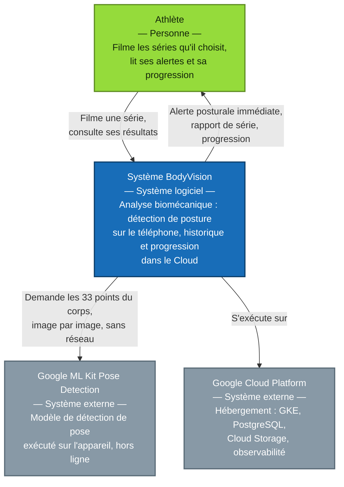
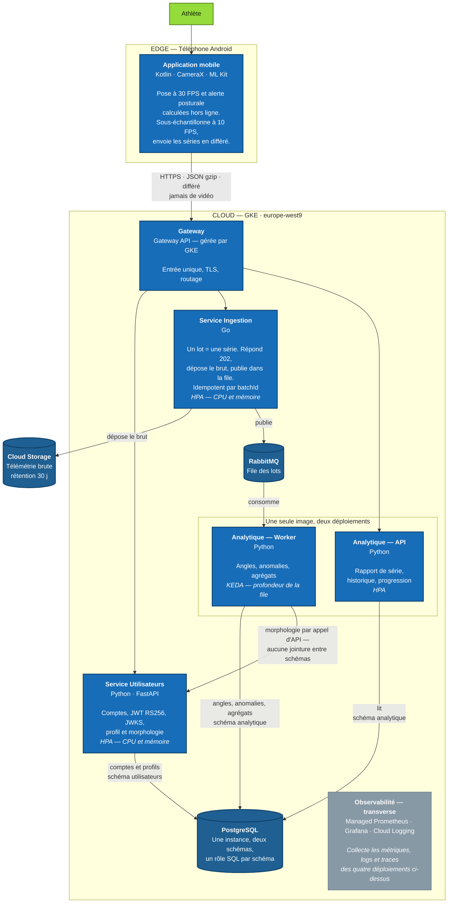
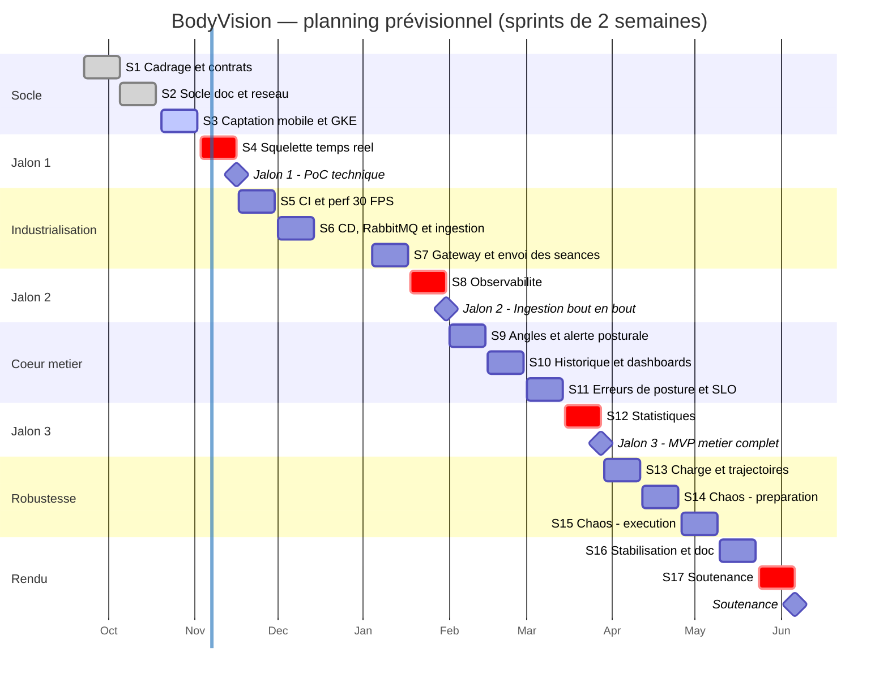

<h1 align="center">BodyVision</h1>

  <strong>Analyse biomécanique Edge &amp; Cloud</strong> 
  Projet thématique — Master 2 Cloud Computing &amp; Mobility, INSSET

---

BodyVision est une application Android qui analyse la posture pendant les exercices de
musculation et prévient l'utilisateur lorsque son mouvement l'expose à une blessure.

La détection de pose s'exécute **sur le téléphone** : l'alerte s'affiche pendant la série,
sans réseau et sans latence. Seules les coordonnées articulaires partent ensuite vers le
Cloud, en différé, pour construire l'historique et la progression. **Aucune vidéo ne quitte
l'appareil.**

L'intérêt du sujet est qu'il force les deux moitiés du master à coexister : du *Machine
Learning* embarqué sur mobile d'un côté, une architecture microservices sur Kubernetes de
l'autre, avec une contrainte de bande passante qui conditionne les deux.

|  |  |
|---|---|
| **Formation** | Master 2 Cloud Computing & Mobility — INSSET, Saint-Quentin |
| **Période** | septembre 2026 → juin 2027 |
| **Méthode** | Scrum, sprints de 2 semaines, approche API-First |
| **Soutenance** | juin 2027 |

## L'équipe

| Membre | Rôle |
|---|---|
| **Jayson Poncey-Valdemar** | Lead architecte, application mobile Edge, gestion du projet |
| **Raphaël Verchain** | DevSecOps, infrastructure et SRE |
| **Brice Ngongang** | Backend et données |

Rituels le dimanche : point d'étape à mi-sprint, rétrospective et planification en fin de
sprint. Le reste de la collaboration est asynchrone, sans blocage mutuel.

## Les dépôts

| Dépôt | Contenu |
|---|---|
| [`bodyvision-contracts`](https://github.com/BodyVision-CCM/bodyvision-contracts) | Contrat OpenAPI — la source de vérité des interfaces |
| [`bodyvision-mobile`](https://github.com/BodyVision-CCM/bodyvision-mobile) | Application Android — Kotlin, CameraX, ML Kit |
| [`bodyvision-user-service`](https://github.com/BodyVision-CCM/bodyvision-user-service) | Service Utilisateurs — Python, FastAPI |
| [`bodyvision-analytics-service`](https://github.com/BodyVision-CCM/bodyvision-analytics-service) | Service Analytique — Python, API et worker |
| [`bodyvision-infrastructure`](https://github.com/BodyVision-CCM/bodyvision-infrastructure) | Terraform — VPC, GKE, IAM, Artifact Registry |

Le service Ingestion, écrit en Go, aura son dépôt à l'ouverture de son développement.

## Architecture

BodyVision analyse la posture **sur le téléphone** et n'envoie au Cloud que des
coordonnées articulaires, jamais de vidéo. Le Cloud conserve l'historique, calcule
la progression et absorbe les rafales d'envoi.

### Niveau 1 — Contexte

### Niveau 2 — Conteneurs

Trois images Docker, quatre déploiements : l'API et le worker du service Analytique
partagent la même image et ne diffèrent que par leur point d'entrée.

### Ce que le diagramme fige

| Décision | Où elle se lit |
|---|---|
| Aucune vidéo ne quitte le téléphone | Arête `Application mobile → Gateway` |
| L'alerte posturale est calculée hors ligne | Conteneur `Application mobile` |
| 30 FPS pour l'alerte, 10 FPS vers le Cloud | Conteneur `Application mobile` |
| Ingestion en Go, isolée du reste | Conteneur `Service Ingestion` |
| 3 images, 4 déploiements | Cadre `Une seule image, deux déploiements` |
| Ingestion asynchrone, réponse `202` | `Ingestion → RabbitMQ → Worker` |
| Rejeu sans doublon | `Idempotent par batchId` |
| La télémétrie brute n'est jamais en base | `Ingestion → Cloud Storage`, rétention 30 j |
| Une instance PostgreSQL, un schéma par service | Conteneur `PostgreSQL` |
| Aucune jointure entre schémas | Arête `Worker → Service Utilisateurs` |
| HPA sur les API, KEDA sur le worker | Mentions `HPA` et `KEDA` dans les conteneurs |

## Planning prévisionnel

Dix-sept sprints de deux semaines, de septembre 2026 à juin 2027. Les sprints en rouge
portent un jalon : ce sont les quatre échéances qui ne peuvent pas glisser. La barre
verticale marque la date du jour, et l'interruption entre décembre et janvier correspond
aux congés universitaires.

Ce planning est le reflet du tableau Jira de l'équipe, qui reste la référence.

### Les quatre jalons

| Jalon | Échéance | Ce qui doit être démontrable |
|---|---|---|
| **Jalon 1** — PoC technique | mi-novembre 2026 | Squelette filaire affiché en temps réel sur le téléphone, et extraction du JSON de télémétrie |
| **Jalon 2** — Ingestion bout en bout | fin janvier 2027 | Une séance filmée traverse toute la chaîne jusqu'à la base, avec OpenTelemetry et Grafana opérationnels |
| **Jalon 3** — MVP métier | fin mars 2027 | Détection des erreurs de posture, tableau de bord de progression et alerting |
| **Soutenance** | juin 2027 | Démonstration en direct d'une panne et de l'auto-guérison |

Les trois sprints qui suivent le jalon 3 n'ajoutent aucune fonctionnalité : ils servent à
prouver que le système tient. Tests de charge et validation de l'autoscaling, puis pannes
volontaires pour vérifier l'auto-guérison et l'idempotence du consumer.

## Comment on travaille

**API-First.** Le contrat OpenAPI vit dans son propre dépôt et sa branche `main` fait foi.
Il précède l'implémentation, ce qui permet au mobile de développer contre un serveur de
simulation avant que le backend existe. Il est validé automatiquement par Spectral.

**Trunk-Based Development.** Branche `main` protégée, revue croisée obligatoire avant toute
fusion. Aucune branche de longue durée.

**Tout en Infrastructure as Code.** L'environnement GCP est décrit en Terraform et
entièrement recréable. Il est volontairement éphémère : créé avant une session de test,
détruit après, ce qui est la principale mesure de maîtrise des coûts.

**Sécurité dans la chaîne de build.** Analyse statique et scan de vulnérabilités des images
avec Trivy, directement dans les pipelines.

---

Projet académique — UE Projet Thématique, M2 CCM, INSSET (Université de Picardie Jules Verne)

