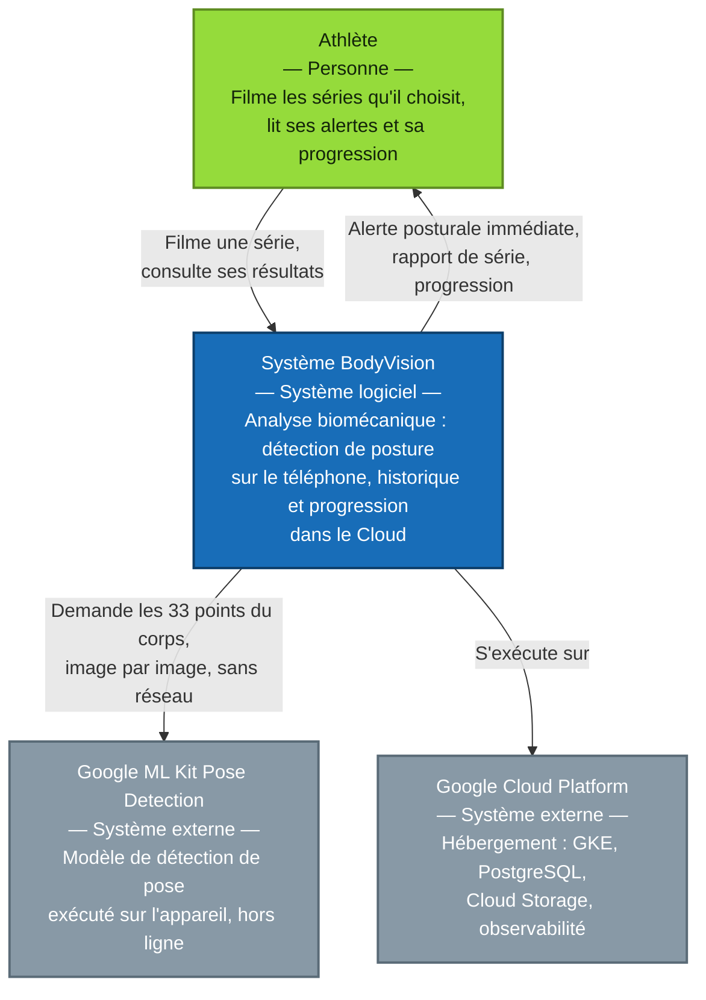
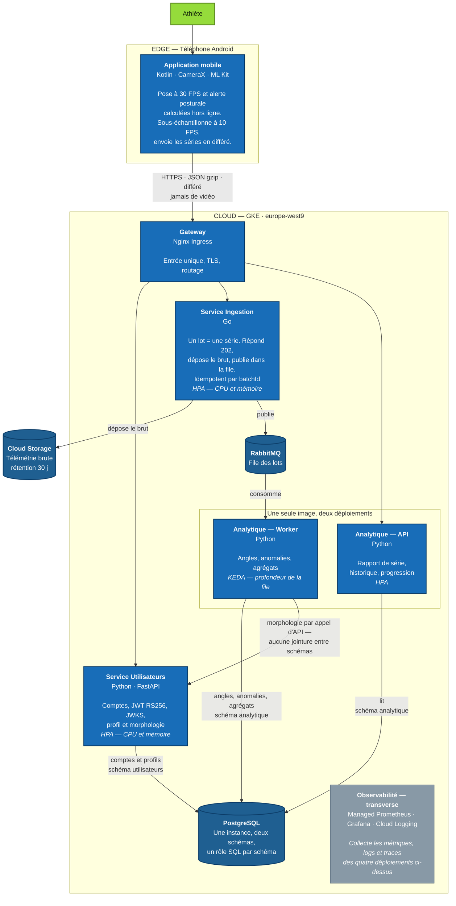

## Architecture

BodyVision analyse la posture **sur le téléphone** et n'envoie au Cloud que des
coordonnées articulaires, jamais de vidéo. Le Cloud conserve l'historique, calcule
la progression et absorbe les rafales d'envoi.

### Niveau 1 — Contexte

### Niveau 2 — Conteneurs

Trois images Docker, quatre déploiements : l'API et le worker du service Analytique
partagent la même image et ne diffèrent que par leur point d'entrée.

### Ce que le diagramme fige

| Décision | Où elle se lit |
|---|---|
| Aucune vidéo ne quitte le téléphone | Arête `Application mobile → Gateway` |
| L'alerte posturale est calculée hors ligne | Conteneur `Application mobile` |
| 30 FPS pour l'alerte, 10 FPS vers le Cloud | Conteneur `Application mobile` |
| Ingestion en Go, isolée du reste | Conteneur `Service Ingestion` |
| 3 images, 4 déploiements | Cadre `Une seule image, deux déploiements` |
| Ingestion asynchrone, réponse `202` | `Ingestion → RabbitMQ → Worker` |
| Rejeu sans doublon | `Idempotent par batchId` |
| La télémétrie brute n'est jamais en base | `Ingestion → Cloud Storage`, rétention 30 j |
| Une instance PostgreSQL, un schéma par service | Conteneur `PostgreSQL` |
| Aucune jointure entre schémas | Arête `Worker → Service Utilisateurs` |
| HPA sur les API, KEDA sur le worker | Mentions `HPA` et `KEDA` dans les conteneurs |
